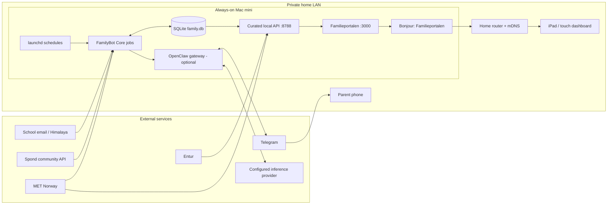
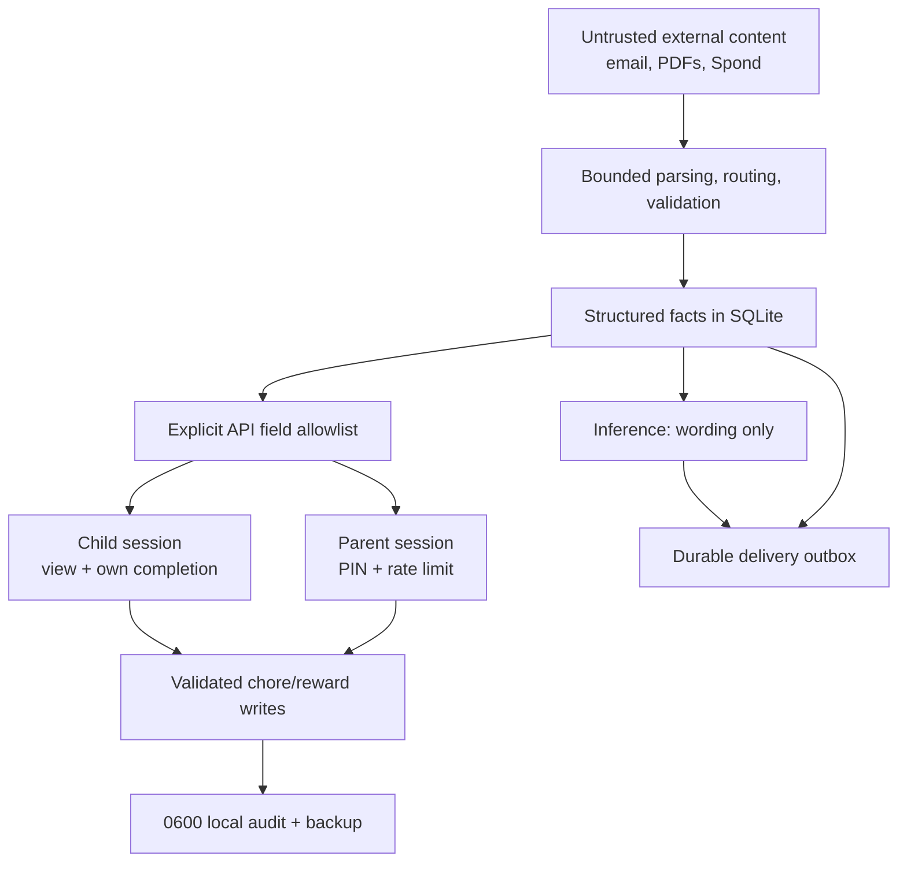
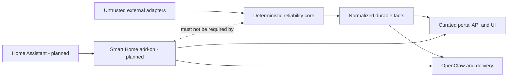

# Architecture

FamilyBot is a local-first Norwegian family information service. Deterministic
jobs collect and store facts; optional inference improves wording; the iPad
dashboard and Telegram expose curated views.

This document describes the running family-information architecture. Planned
add-ons are explicitly labelled and may not be treated as deployed services.

## Physical topology



The browser is a family appliance, not an OpenClaw administration console. It
cannot read raw email, credentials, raw Spond payloads or arbitrary files, and
it cannot trigger scheduled ingestion or Telegram delivery.

## Data and trust boundaries



Inference is outside the durability boundary. If it fails, deterministic
briefings, ingestion state, retries and dashboard data remain available.

## Runtime layout

```text
Git checkouts/                         reviewed, non-private source
  familybot-core/
  familybot-portal/

$HOME/.familybot/                     private durable state for new installs
  config/family.local.json
  config/parent-pin.txt
  db/family.db
  scripts/
  secrets.env
  attachments/, logs/, memory/, backups/

$HOME/.familybot/runtime/familybot-portal/ generated deployed portal
$HOME/Library/LaunchAgents/                reviewed schedules/supervisors
```

Existing households may keep an older `$HOME/.openclaw/workspace` path through
`FAMILYBOT_WORKSPACE`; migration does not require moving private state.

Source control is not a household backup. See [REDEPLOY.md](REDEPLOY.md) for
the source/state/credential restore order and [SECURITY.md](SECURITY.md) for
the threat model.

## Core and add-on dependency rule

The dashboard profile deploys no Core runtime and requires no integration
package. Connected/Agent Core deployment starts with the stdlib-only base lock,
then adds the hash-locked PDF or unofficial Spond dependency set only when that
adapter is explicitly enabled. `requirements.txt` remains the aggregate test
and contributor lock; it is not evidence that every package is required by a
household profile.



Core owns ingestion completion, fact durability, briefings, outbox delivery and
health. Add-ons may consume curated facts or own separate schemas, but they do
not change core completion state. The detailed ownership map is in
[`docs/REPOSITORY_GUIDE.md`](docs/REPOSITORY_GUIDE.md).

## Schema and profile contract

Both repositories share one SQLite file but not implicit table ownership.
`familybot_schema_migrations` records component, version, migration name and
checksum. Core currently requires `core:1`; Portal requires `core:1` and owns
`portal:1..2`. Migrations run transactionally, back up an existing database
before a pending change and fail closed on an unknown future version or changed
checksum.

The runtime footprint is selected by configuration:

- Dashboard: Portal only; no Core background schedule or external account.
- Connected: only configured deterministic adapters and their health/status.
- Agent: Connected plus isolated model-assisted interpretation, durable
  briefing delivery and Telegram.

Optional adapters must fail independently. Their absence cannot make SQLite,
the dashboard, chores or rewards unavailable.

## Planned Smart Home topology

Home Assistant is the proposed broker on the Mac mini. Home-local devices may
use local protocols. Cabin devices are cloud-backed until a cabin-side broker
and reviewed VPN exist. This topology, device research and acceptance criteria
are specified in [`specs/SMART_HOME.md`](specs/SMART_HOME.md); no Home Assistant
runtime is currently implied by this diagram.
